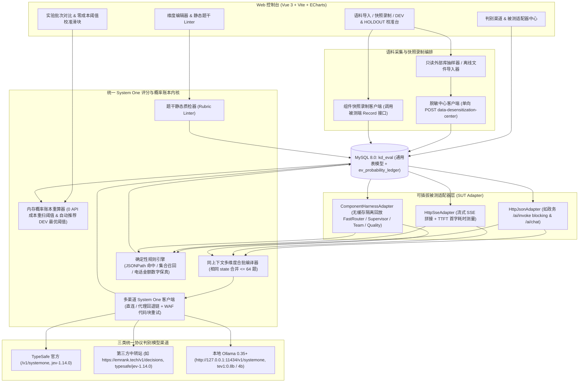

# 系统架构与内核详细设计：AI 评测中心

## 1. 整体架构图



---

## 2. 统一 System One 决策协议与多渠道适配细节

### 2.1 标准电文契约（三端通用）
无论是官方 TypeSafe、第三方决策中转站（[EMRank API 文档](https://docs.emrank.tech/api/decisions)）还是本地 Ollama `tev1:0.8b`（`/v1/systemone`），请求体与响应体遵循同一规范：

**请求报文 (`POST <provider.endpoint_url>`)**：
```json
{
  "model": "typesafe/jev-1.14.0",
  "state": {
    "input": "在常州提取住房公积金偿还商业房贷需要什么材料？",
    "actual_output": "您需要携带身份证、银行卡、借款合同及近一年还款明细，也可在常州公积金微信公众号线上办理，咨询热线 12329。",
    "expected_output": "线上可通过常州住房公积金微信公众号零材料刷脸申办；线下需身份证、一类银行卡、商业贷款合同及还款明细，咨询电话 12329。",
    "references": ["..."]
  },
  "questions": {
    "dim_gov_policy_v1__core_conclusion": {
      "type": "score",
      "instructions": "对比 expected_output，actual_output 给出的核心办理结论与要件是否准确？",
      "criteria": [
        "核心结论错误，或与 expected_output 直接矛盾",
        "结论部分正确，但遗漏关键办理渠道或核心前置条件",
        "核心结论、办理渠道与关键材料均准确完整"
      ]
    },
    "dim_gov_policy_v1__no_fabrication": {
      "type": "noul",
      "instructions": "actual_output 中没有编造 references 与 expected_output 之外的虚假收费标准、电话号码或政策文号。"
    },
    "dim_gov_policy_v1__action_guidance": {
      "type": "choice",
      "instructions": "当用户问题询问具体如何申办时，actual_output 对线上/线下办理路径的说明情况如何？",
      "criteria": {
        "missing_or_wrong": "未提供办理路径或路径信息错误",
        "partial": "仅提及单一路径，遗漏更便捷的线上或线下备选路径",
        "clear_and_complete": "清晰完整地说明了可行的办理路径",
        "not_applicable": "用户仅咨询概念定义，不涉及具体申办路径"
      }
    }
  }
}
```
> **渠道差异处理细节**：
> 1. **鉴权头**：当 `provider.api_key` 非空时注入 `Authorization: Bearer <api_key>`；本地 Ollama 默认免密可留空。
> 2. **网络路由**：`OLLAMA_LOCAL` 或 `network_mode = "DIRECT"` 时使用 `httpx.AsyncClient(trust_env=False)` 强制直连；`PROXY_FALLBACK` 按 `http://127.0.0.1:10808` → `http://127.0.0.1:7897` → 直连顺序探活并缓存可用通道。
> 3. **边缘防火墙 HTML 403 自愈**：部分云端网关边缘 WAF 会将含 shell/SQL 片段的 `state` 误拦为 HTML `403`；若 `waf_strip_code_retry = 1` 且响应 `status == 403`、正文以 `<` 开头，客户端自动剥离围栏代码块重试一次并标记 `waf_fallback_used = true`。
> 4. **扩展参数与链路追踪**：对 `OLLAMA_LOCAL` 支持合并 `extra_options_json`（如 `{"keep_alive": "15m"}`）；对响应头存在 `X-Request-ID`（如 EMRank）的渠道自动提取写入 `ev_probability_ledger.upstream_request_id`。

### 2.2 同上下文多维度合批编译器 (`StateBatchCompiler`)
在套件评测单条用例时，假设套件包含 `rag_faithfulness`、`answer_relevancy`、`gov_policy_accuracy` 共 3 个维度（合计 8 道原子题）：
1. 按规范化排序后的 `tuple(sorted(dimension.state_fields))` 对维度分组；
2. 同一分组构造唯一一份 `state` JSON，将该组内所有维度的原子题以 `{dimension_code}_v{ver}__{question_key}` 命名空间合并进同一个 `questions` 字典；
3. 若合并后题数超过渠道上限 `max_questions_per_call`（`tev1` 上限为 `64`），按 `64` 题切片分批请求；
4. 收到 `answers` 后按命名空间还原回各维度，计算各题期望分与维度加权总分：
   - **`noul`**：得分 $s = p_{\text{true}} \in [0, 1]$，把握度 $c = |2 p_{\text{true}} - 1|$（若上游已返回 `confidence` 则优先取上游值）。
   - **`score`（共 $K$ 档，下标 $0 \dots K-1$ 严格按最差到最好排列）**：归一化得分 $s = \frac{\sum_{i=0}^{K-1} i \cdot p_i}{K - 1} \in [0, 1]$。
   - **`choice`**：每个选项在 `ev_dimension` 中映射分值 $v_k \in [0, 1] \cup \{\text{null}\}$。当所有 `null`（不适用）选项概率之和 $\ge 0.5$ 时，该题标记 `applicable = false` 并从本条用例的权重分母中剔除；否则在适用选项内归一化概率后计算加权期望分。

---

## 3. 题干静态质检器 (`Rubric Linter`)

保存或发布 `SYSTEM_ONE` 维度前，离线执行静态规则检查，阻断 `ERROR` 级反模式并提示 `WARN`：
- **`LINT_OPT_COUNT` (`ERROR`)**：`score` 或 `choice` 选项数不在 `[2, 24]` 区间内（兼容 `tev1` 训练分布上限）。
- **`LINT_SCORE_ORDER` (`ERROR`)**：检测 `score.criteria` 第 0 档是否误填正向满分词汇（如“完全准确 / 无遗漏 / Fully grounded”）而末档填负向词汇，强制要求 **worst-first（第 0 档最差，末档最好）**。
- **`LINT_STATE_FIELD_REF` (`ERROR`)**：题干中显式引用的标准上下文字段名（如 `expected_output`、`references`）未包含在该维度的 `state_fields_json` 中（会导致模型看不见该字段而盲猜）。
- **`LINT_COMPOUND_QUESTION` (`WARN`)**：题干包含多个问号或明显并列多准则连接词（提示拆分为多个独立 `noul` 原子题，交给算术权重合成而非让模型单题兼顾）。
- **`LINT_ARITHMETIC_CHECK` (`WARN`)**：题干要求精确核对多位电话号码、精确加减法或日期差（提示改配 `DETERMINISTIC` 的 `numeric_fact_grounding` 指标）。

---

## 4. 确定性规则评估器 (`Deterministic Evaluators`)

无需调用任何模型、耗时 $< 1\text{ms}$、零成本执行的纯代码评估器：
1. **`json_exact_or_in`**：提取 `actual_structured_json` 指定 JSONPath（如 `$.actual_agent_id` 或 `$.route_type`），核对是否命中 `expected_structured_json` 的目标集合（用于 `FastRouter` / `SupervisorRouter` Top-1 准确率）。
2. **`set_recall_precision`**：对比多智能体并行候选集合（如 `actual_structured_json.selected_agent_ids` 与 `expected_structured_json.expected_agent_ids`）的 Recall / Precision / F1。
3. **`numeric_fact_grounding`**：用正则提取 `actual_output` 中的电话号码、金额、百分比、工作日数，核对是否全部在 `references` 或 `expected_output` 中有据可查，精准补足神经网络对数字串逐位比对的短板。
4. **`latency_sla`**：校验 `sut_latency_ms` 或 `ttft_ms` 是否低于阈值上限。

---

## 5. 双批次语义回归（Baseline Semantic Diff）与零成本阈值校准

1. **四分类语义回归比对**：当发起实验批次指定了 `baseline_run_id` 且开启语义回归检查时，对同一 `case_id` 的 `baseline_output` 与 `current_output` 追加一道 `choice` 判别题：
   - `SAME`：核心政策结论、办理条件与操作指引实质一致（仅措辞、排版或语序不同）；
   - `FACT_DIFFERS`：关键事实、条件、电话、时限或金额发生实质变化；
   - `ACTION_DIFFERS`：建议用户采取的办理渠道、所需材料或下一步动作发生变化；
   - `SPECIFICITY_DIFFERS`：无事实冲突，但信息详略程度或限定条件完整性显著变化。
2. **零 API 成本阈值重算与 `DEV` 最优阈值寻优**：
   - 每次评测将完整 `raw_answers_json` 写入 `ev_probability_ledger`。
   - 前端报告页拖动某维度阈值 $T_d'$ 或权重 $W_d'$ 时，后端直接加载该批次账本记录，在纯内存中重新判定每题及格态与套件 `pass_policy`（500 条用例 < 20ms），并支持在 `DEV` 分集上结合人工标注正负例网格搜索使 Youden's $J$ 或 $F_1$ 最大的推荐阈值，再一键锁定应用到 `HOLDOUT` 集验真。
