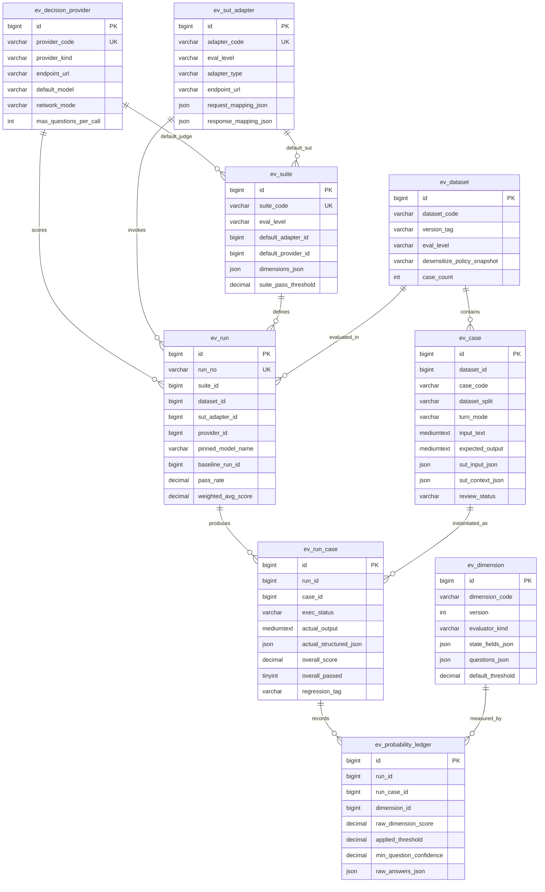

# 数据库模型设计文档：AI 评测中心 (`kd_eval`)

## 1. 核心建模准则

1. **100% 业务无关性（Domain-Agnostic）**：`kd_eval` 共 11 张表，**不包含任何政务路由或单一业务系统的耦合字段**（无 `selected_region`、`java_request_id`、`normal_chat_app_code` 等硬编码列）。所有被测对象特有的请求参数、冻结上下文与返回轨迹均通过 `ev_sut_adapter` 的映射配置收敛于 `sut_input_json`、`sut_context_json`、`actual_structured_json` 与 `sut_trace_json`。
2. **标尺与版本强不可变**：
   - `ev_dimension` 以 `(dimension_code, version)` 唯一约束固化题干与档位；
   - `ev_run` 强快照记录本次执行使用的 `provider_id`、`pinned_endpoint_url`、`pinned_model_name` 与 `sut_fingerprint_json`，防止渠道或模型切换污染历史基准。
3. **原始概率账本一等公民**：`ev_probability_ledger` 独立存储未经及格线截断的原子题全概率分布，支撑零推理成本重算与阈值校准。

---

## 2. 实体关系图 (ER Diagram)


*(注：另含控制台鉴权与自动化触发基础表 `ev_admin_user`、`ev_api_key`，共计 11 张表。)*

---

## 3. 十一张表清单与核心 JSON 契约

| 序号 | 表名 | 职责说明 |
| --- | --- | --- |
| 1 | `ev_admin_user` | 独立 Web 控制台本地用户表（JWT 登录） |
| 2 | `ev_api_key` | CI/CD 或外部脚本触发评测的 `evk_*` API Key 表（仅存前缀与 `SHA-256`） |
| 3 | `ev_decision_provider` | **判别模型渠道配置表**：统一管理 TypeSafe 官方、EMRank 等第三方中转站及本地 Ollama `tev1` 端点、密钥密文、代理策略与合批上限 |
| 4 | `ev_sut_adapter` | **可插拔被测适配器表**：管理被测 HTTP/SSE 接口或组件回放 Harness 的端点、鉴权与出入参 JSONPath 映射规则 |
| 5 | `ev_dimension` | **评价维度版本表**：按 `(dimension_code, version)` 存储 System One 原子题定义或确定性评估规则及静态 Linter 报告 |
| 6 | `ev_suite` | **评测套件表**：组装多维度版本、权重、一票否决（`is_blocker`）、综合及格线与低把握度复核线 |
| 7 | `ev_dataset` | **测试集版本主表**：记录数据集版本、适用层级（`E2E`/`COMPONENT`）及脱敏策略溯源快照 |
| 8 | `ev_case` | **通用黄金用例表**：承载 `DEV`/`HOLDOUT` 分集、单/多轮输入、标准答案、参考上下文、结构化期望 `expected_structured_json`、E2E 附加参数 `sut_input_json` 及组件冻结快照 `sut_context_json` |
| 9 | `ev_run` | **实验批次主表**：固化套件、测试集分集筛选、SUT 版本指纹、判别渠道与模型快照、基线批次 ID、耗时 P50/P95/TTFT、Token 消耗及维度涨跌汇总 |
| 10 | `ev_run_case` | **单条用例执行快照表**：记录本次 SUT 实际输出、召回引用、提取的结构化结果、轨迹快照、综合得分、是否需人工复核及语义回归标签 `regression_tag` |
| 11 | `ev_probability_ledger` | **原始概率账本明细表**：记录每个 `(run_case_id, dimension_id)` 下各道 `noul`/`score`/`choice` 原子题的完整概率分布、适用性剔除标志与上游 `X-Request-ID` |

### `ev_probability_ledger.raw_answers_json` 存储结构示例

```json
{
  "questions": [
    {
      "key": "core_conclusion",
      "type": "score",
      "weight": 2.5,
      "applicable": true,
      "normalized_score": 0.9150,
      "raw_weighted_level": 1.8300,
      "probabilities": { "0": 0.0200, "1": 0.1300, "2": 0.8500 },
      "confidence": 0.7750
    },
    {
      "key": "no_fabrication",
      "type": "noul",
      "weight": 2.0,
      "applicable": true,
      "normalized_score": 0.9820,
      "p_true": 0.9820,
      "confidence": 0.9640
    },
    {
      "key": "action_guidance",
      "type": "choice",
      "weight": 1.5,
      "applicable": false,
      "normalized_score": null,
      "chosen": "not_applicable",
      "probabilities": {
        "missing_or_wrong": 0.03,
        "partial": 0.05,
        "clear_and_complete": 0.12,
        "not_applicable": 0.80
      },
      "confidence": 0.7333
    }
  ]
}
```

---

## 4. 物理建表与初始化脚本路径

- 完整 DDL：[docs/sql/01_schema.sql](./sql/01_schema.sql)
- 三类判别渠道、政务 E2E/Component 适配器与默认维度套件种子：[docs/sql/02_seed_defaults.sql](./sql/02_seed_defaults.sql)
