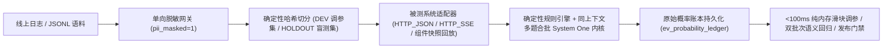

# AI 评测中心：产品功能介绍与实操演示手册

> **适用版本**：v1.0  
> **配套演示种子模块**：`backend/app/db/seed_demo.py`

---

## 一、产品定位与核心功能介绍

**AI 评测中心（AI Evaluation Center）** 是面向企业级大模型与多智能体应用（如政务智能客服、知识库问答、智能路由编排）构建的**确定性概率评测与防过拟合门禁工作台**。

传统“让通用大模型写评语打 1~5 分”的生成式评测存在三大痛点：**多次运行结果漂移、长思维链推理成本高昂、修改及格线必须重跑全量模型**。本系统通过“**确定性代码规则优先 + System One 单 Token 概率原语 + 原始概率账本落盘 + DEV/HOLDOUT 物理隔离**”四层架构彻底解决上述问题。



### 六大核心能力模块

| 模块 | 核心能力说明 | 解决的工程痛点 |
| --- | --- | --- |
| **1. 多源判别模型渠道与弹性容灾** | 统一封装本地 **Ollama (`tev1:0.8b`)**、第三方决策中转 **EMRank (`/v1/decisions`)** 与 **TypeSafe 官方云端 (`/v1/systemone`)**；内置代理优先与直连回退通道记忆（`PROXY_FALLBACK`），以及云端边缘 WAF `403` 自动剥离代码块重试机制（`waf_strip_code_retry`）。 | 日常高频回归用本地 0.8B 零成本跑批，发版门禁一键切换云端高精度模型，不被网络抖动或代码片段触发 WAF 中断。 |
| **2. 同上下文合批与确定性规则混合内核** | 内置 4 类零成本代码评估器（JSON 精确/集合包含、集合召回/精确率、电话/金额/工作日数字事实核对、流式首字 TTFT 与总耗时 SLA）；对共享相同 `state_fields` 的多个 System One 维度自动合并为单次请求（上限 `<= 64` 题/次，超限自动分片）。 | 机械核对绝不浪费模型 Token；多维度评测网络请求数与输入 Token 开销直降 50%~75%。 |
| **3. 题干静态质检（Rubric Linter）与不可变版本** | 创建或修改 System One 维度时强制执行 5 项静态语法检查（字数上限、禁用复合连词一题多问、禁用模糊程度词、禁用诱导思维链词汇、校验判断句闭环）；任何修改自动生成新版本（`v1 -> v2`），严禁覆盖历史版本。 | 从源头消灭模糊题干导致的概率漂移，确保三个月前的历史跑批报告依然精确绑定当时的题干快照。 |
| **4. 双层可插拔被测适配器（E2E + 组件快照）** | 支持端到端 `HTTP_JSON`、流式 `HTTP_SSE`（自动精确采集首字延迟 `ttft_ms`）以及面向内部路由/汇总模块的 `COMPONENT_HARNESS`（先在线录制一次 `sut_context_json` 冻结快照，后续脱离外网与业务库毫秒级回放消融）。 | 既能做全链路发版验收，又能固定检索上下文单独对路由温度、提示词做无噪声单变量消融实验。 |
| **5. 单向脱敏治理与主动学习真值校准台** | 采集入库强制记录脱敏策略快照；未完成脱敏（`pii_masked=0`）的样本后端硬性拦截入库（`400`）；每轮跑批自动将模型最低置信度换算为样本不确定度 `uncertainty_score = 1 - min_confidence`，校准队列按不确定度降序优先呈现边界样本。 | 杜绝公民隐私明文进入黄金测试集，让业务专家把有限精力集中在模型最拿不准的 10% 疑难样本上。 |
| **6. 原始概率账本、毫秒级重算与语义回归** | 逐题落盘原始概率分布；在报告页拖动阈值/权重/一票否决滑块时，基于内存账本 `< 100ms` 零成本重算全量通过率与翻转样本；提供基于 `DEV` 人工标签的 `Youden's J` / `F1` 网格寻优，并对 `HOLDOUT` 盲测集硬性锁死寻优接口防止过拟合；支持双批次 4 分类语义回归对比与跨模型标尺告警。 | 调阈值无需重跑大模型；杜绝“看着盲测集调参”的虚假高分；跨版本回答变化一目了然。 |

---

## 二、访问入口与已初始化的演示数据全景

### 1. 环境访问信息

- **Web 控制台地址**：http://127.0.0.1:5173/ （开发态实时热更新）或 http://127.0.0.1:18200/ （后端单端口托管）
- **后端 OpenAPI 文档**：http://127.0.0.1:18200/docs
- **管理员登录账号**：`admin`
- **管理员登录密码**：`admin123456`

> **重复初始化说明**：演示数据脚本具有幂等保护，随时可在 `backend/` 目录执行 `python -m app.db.seed_demo` 检查或在新数据库（如切换至 MySQL `kd_eval` 后）一键重灌全套演示案例。

### 2. 预置演示资产速查表

本次已通过真实评测内核全链路运行并落盘以下“常州政务智能客服”演示数据：

#### （1）渠道、适配器与自动化密钥（对应菜单：**渠道与适配器** `/providers`）
- **3 个判别模型渠道**：
  - `ollama_local_tev1`：本地 Ollama `tev1:0.8b`（默认渠道，健康状态 `正常`，`DIRECT` 直连，零成本）
  - `emrank_decisions_relay`：EMRank 决策中转 `/v1/decisions`（健康状态 `正常`，已预置脱敏密钥掩码 `sk-****9a2f`，开启 `PROXY_FALLBACK` 与 `WAF 代码块剥离重试`）
  - `typesafe_official`：TypeSafe 官方云端（演示“待配置密钥/探测失败”告警态）
- **4 个被测系统适配器**（覆盖全部 3 种协议类型）：
  - `gov_e2e_routing_blocking`（`E2E` · `HTTP_JSON`）
  - `gov_e2e_normal_chat`（`E2E` · `HTTP_JSON`）
  - `gov_e2e_routing_sse`（`E2E` · `HTTP_SSE` 流式首字 TTFT 采集）
  - `gov_comp_routing_harness`（`COMPONENT` · `COMPONENT_HARNESS` 录制与回放网关）
- **2 枚流水线 API Key**：`ci-nightly-regression-bot`（`ACTIVE`，`300 RPM`）与 `legacy-import-script-2025`（`REVOKED` 已吊销对照）。

#### （2）评价维度与评测套件（对应菜单：**维度与套件** `/dimensions`）
- **7 个评价维度（含多版本演进）**：
  - 确定性规则维度：`route_top1_match@v1`（路由命中）、`numeric_fact_grounding@v1`（电话/金额/时限数字核对）、`citation_latency_sla@v1`（TTFT `<= 800ms` 且总耗时 `<= 2500ms`）
  - System One 概率维度：`rag_faithfulness_s1`（含 **`v1` 与升级版 `v2`** 两个不可变历史版本）、`answer_relevancy_s1@v1`（与 `rag_faithfulness_s1@v2` 共享三元组上下文自动合批）、`policy_and_action_accuracy_s1@v1`、`multi_turn_coherence_s1@v1`
- **3 个评测套件**：含旗舰演示套件 **`suite_gov_sse_batch_demo_v1`（政务智能客服 SSE 全链路合批验收套件）**，单样本同时驱动 3 个确定性维度 + 3 个概率维度（共 9 道原子判题压缩为 2~3 次模型调用）。

#### （3）测试集与待校准队列（对应菜单：**测试集与校准** `/datasets`）
- **`gov_cs_e2e_golden`（`v2026.11`，政务智能客服黄金验收与校准集，共 16 题）**：
  - `DEV` 已审样本 **6 题**（覆盖公积金贷款上限、异地购房提取、新生儿医保、灵活就业补贴、预包装食品备案、虚假创业红包反诱导，带人工真值标签 `GT:PASS` / `GT:FAIL`）
  - `HOLDOUT` 盲测样本 **6 题**（覆盖商转公、生育津贴免申即享、不动产抵押注销、尊老金、个体户年报信用修复、青年人才租房补贴）
  - `PENDING_REVIEW` 待校准队列 **4 题**（按不确定度 `0.492 -> 0.315` 降序排列，含 **1 条未脱敏拦截演示样本 `gov_pending_02_unmasked_guard_demo`** 与 **1 条多轮追问样本 `gov_pending_04_multiturn_upgrade`**）
- **`gov_routing_comp_snapshots`（`v1.2`，智能路由与汇总组件冻结快照集，共 6 题）**：全部已完成 `/record-component-snapshots` 冻结上下文录制（`has_snapshot = true`）。

#### （4）5 个真实评测批次（对应菜单：**实验跑批** `/runs` & **报告与阈值校准** `/reports`）

| 批次号 (`run_no`) | 批次名称 | 切分集 | 判别模型 | 通过率 / 加权均分 | 核心演示看点 |
| --- | --- | --- | --- | --- | --- |
| `RUN_20261112_0001` | 政务客服 v2.3.0 基线评测 (DEV 调参集) | `DEV` | `tev1:0.8b` | `33.3%` / `0.7766` | 旧版基线（遗漏距退休不足5年延长条款、误答预包装食品需办证） |
| `RUN_20261112_0002` | 政务客服 v2.4.0-rc1 检索与提示词重构回归 (DEV) | `DEV` | `tev1:0.8b` | `66.7%` / `0.8921` | **主推演示批次**：通过率提升 `+33.4%`，完整呈现 4 类语义回归标签、`<100ms` 滑块重算与 `DEV` 最优阈值推荐（`Youden's J = 1.0`） |
| `RUN_20261112_0003` | 政务客服 v2.3.0 盲测基线 (HOLDOUT · 本地模型) | `HOLDOUT` | `tev1:0.8b` | `83.3%` / `0.8958` | 盲测集本地模型基线对照 |
| `RUN_20261112_0004` | 政务客服 v2.4.0 发布门禁盲测验收 (HOLDOUT · EMRank 云端) | `HOLDOUT` | `typesafe/jev-1.14.0` | `83.3%` / `0.9273` | **安全护栏全演示**：① `HOLDOUT` 锁定禁止自动寻优；② 对比 `0003` 触发**跨判别模型标尺告警**；③ 含 **WAF 403 剥代码块自愈**记录与云端 Token 成本核算（`0.00171` USD） |
| `RUN_20261112_0005` | FastRouter 温度 T=0.0 组件快照零网络回放消融 | `ALL` | `tev1:0.8b` | `100.0%` / `0.9377` | 组件级冻结快照毫秒级零外网回放消融 |

---

## 三、六大核心场景分步操作手册（建议按序演示）

### 场景 1：判别模型渠道探测、被测适配器管理与 CI 密钥签发

1. 打开浏览器访问 http://127.0.0.1:5173/login ，使用 `admin` / `admin123456` 登录。
2. 点击左侧导航 **【渠道与适配器】**（`/providers`）：
   - **判别模型渠道页签**：查看本地 Ollama、EMRank 中转与 TypeSafe 官方三条渠道的认证模式、代理策略（`DIRECT` / `PROXY_FALLBACK`）、合批上限（`64 题/次`）与单价。点击 **「编辑」** 可体验保留扩展参数（`extra_options_json`）与密钥掩码保护；在接入真实本地 Ollama 或云端 Key 后点击 **「连通性探测」** 与 **「拉取模型列表」** 即可实时校验概率接口。
   - **被测系统适配器页签**：查看 `HTTP_JSON`、`HTTP_SSE`（含流式 JSONPath 提取）与 `COMPONENT_HARNESS` 三种适配器配置，支持输入单条测试语句在线调试请求映射与响应抽取预览。
   - **自动化 API Key 页签**：点击 **「新建 API Key」**，输入名称（如 `github-actions-gate`）与每分钟限流（如 `120 RPM`），系统将一次性展示 `evk_live_*` 明文密钥（服务端仅存 SHA-256 摘要）。

---

### 场景 2：题干静态质检（Rubric Linter）与维度不可变版本演进

1. 点击左侧导航 **【维度与套件】**（`/dimensions`）。
2. 在维度列表中找到 **`rag_faithfulness_s1`（知识引用忠实度与零编造）**，点击查看详情：
   - 可看到系统同时保留了 **`v1`（2 道原子题）** 与 **`v2`（新增政策时效核对题 `policy_timeliness`）** 两个历史版本，旧套件绑定 `v1` 不受 `v2` 升级影响。
3. **现场演示 Rubric Linter 静态拦截**：
   - 点击 **「新建评价维度」**，选择评估器类型 `SYSTEM_ONE`，新增一道 `noul` 原子题，故意输入违规题干：
     > `请一步步思考并分析回答是不是全面而且比较准确？`
   - 点击 **「静态质检 (Lint)」** 或尝试保存，前端会立即结构化标红拦截原因：
     - `LINT_REASONING_PROMPT`：包含诱导长思维链推理词汇（“一步步思考”），破坏 System One 单 Token 直觉概率判别；
     - `LINT_MULTI_CONCEPT`：包含并列复合连词（“而且”），违反一题一概念原子性原则；
     - `LINT_SUBJECTIVE_GRADING`：包含无锚点模糊程度词（“比较”）。
   - 修改为客观单一陈述句（如：`actual_output 给出的办理时限与 references 完全一致。`），再次点击质检即可全绿通过。

---

### 场景 3：主动学习真值校准台与“未脱敏禁入”安全护栏

1. 点击左侧导航 **【测试集与校准】**（`/datasets`）。
2. 选中 **`gov_cs_e2e_golden`（政务智能客服黄金验收与校准集）**：
   - 顶部统计卡清晰展示 `DEV: 6`、`HOLDOUT: 6`、`待校准: 4` 及脱敏策略快照 `gov_eval_corpus:v2.3`。
3. 筛选审核状态为 **`待审核 (PENDING_REVIEW)`**（默认按 `uncertainty_score` 降序排列，最上方 `gov_pending_01_high_uncertainty` 不确定度达 `0.492`）：
   - **演示安全护栏拦截**：点击第 2 条样本 **`gov_pending_02_unmasked_guard_demo`**（注意其脱敏状态为“未脱敏” `pii_masked=0`），不勾选已脱敏直接点击 **「审核通过 (APPROVED)」** —— 系统立即弹出红色错误提示，拒绝未脱敏语料进入正式评测集。
   - **完成脱敏并入库**：人工核对并移除敏感信息后，打开 **「确认已完成隐私脱敏 (`pii_masked=1`)」** 开关，填写校准备注并点击 **「审核通过」**，样本即刻合规入库，`DEV` 可用样本数同步自动 `+1`。
4. 切换左侧测试集至 **`gov_routing_comp_snapshots`（智能路由与汇总组件冻结快照集）**：
   - 可查看每条样本均带有 **「已录制快照」** 徽标，点开样本即可检视冻结的 `candidate_agents` 与 `selected_region` 入参上下文。

---

### 场景 4：实验跑批管理与创建新评测任务

1. 点击左侧导航 **【实验跑批】**（`/runs`）：
   - 列表展示了全部 5 个预置批次的运行状态、切分集徽标（`DEV` 蓝标 / `HOLDOUT` 琥珀锁定标）、绑定的判别模型、通过率、加权均分与耗时。
   - 也可点击右上角 **「发起评测跑批」**，选择套件、测试集切分（日常调优默认 `DEV`，上线门禁选 `HOLDOUT`）、基线批次以及版本指纹（如 `{"git_sha": "main", "prompt_ver": "v2.5"}`）创建新批次；运行中的任务支持二次确认取消（`<el-popconfirm>` 防误触）。

---

### 场景 5：核心亮点——`<100ms` 零成本滑块校准、双批次语义回归与防过拟合门禁

1. 点击左侧导航 **【报告与阈值校准】**（`/reports`），在顶部批次下拉框选择 **`RUN_20261112_0002`（政务客服 v2.4.0-rc1 检索与提示词重构回归 · DEV）**：
   - **KPI 概览卡**：查看通过率（`66.7%`）、加权均分（`0.8921`）、流式首字延迟 `P50 TTFT`、总耗时 `P95`、同上下文合批节省率以及估算评测成本。
   - **分布与回归可视化面板**：左侧展示各评价维度的通过率与概率分布直方图，右侧展示相对基线 `RUN_20261112_0001` 的 **4 分类语义回归统计**（`SAME: 2` 无实质变化、`SPECIFICITY_DIFFERS: 1` 详略差异、`ACTION_DIFFERS: 2` 办事指引变化、`FACT_DIFFERS: 1` 核心事实变化，全部采用颜色+文字双编码无障碍标签）。
2. **体验 `<100ms` 纯内存零成本滑块调参**：
   - 在 **「纯内存阈值与权重校准台」** 面板中，拖动任意维度的及格阈值滑块（例如将 `policy_and_action_accuracy_s1` 阈值从 `0.75` 下调至 `0.55` 或上调至 `0.90`），或切换 `Blocker`（一票否决）开关：
   - 无需发起任何大模型请求，后端在 **几毫秒内** 基于落盘概率账本返回重算后的全量通过率变化量（`Delta`）及具体发生结果翻转的样本 ID（`flipped_case_ids`）！
3. **体验 `DEV` 集监督式自动阈值寻优与闭环上线**：
   - 点击校准台上的 **「基于 DEV 真值推荐最优阈值」**（支持 `Youden's J` 与 `F1` 准则）：系统自动基于 `DEV` 样本的人工标签完成网格搜索，给出 `best_youden_j = 1.0` 的推荐阈值组合。
   - 确认阈值满意后，点击 **「锁定阈值至评测套件」** 将参数写回套件配置，随后可一键点击 **「使用锁定配置发起 HOLDOUT 盲测」** 完成从调参到盲测验收的标准工程闭环。
4. **验证三大架构级安全护栏（切换批次至 `RUN_20261112_0004`）**：
   - 在顶部批次选择器切换至 **`RUN_20261112_0004`（政务客服 v2.4.0 发布门禁盲测验收 · HOLDOUT · EMRank 云端）**：
     1. **`HOLDOUT` 防过拟合锁死**：由于该批次运行在 `HOLDOUT` 盲测集上，自动寻优按钮处于禁用保护态（若强行调用接口同样返回 `400` 拦截），彻底杜绝针对盲测集刷分。
     2. **跨判别模型概率标尺不一致告警**：在双批次对比区选择与基线 `RUN_20261112_0003` 对比，顶部自动弹出醒目告警横幅——提示当前批次（`typesafe/jev-1.14.0`）与基线批次（`tev1:0.8b`）使用了不同判别模型，原始概率分数不可直接横向等同，应以同模型标尺对比为准。
     3. **原始概率账本抽屉与 WAF 自愈审计**：在下方样本明细表中点击 **`gov_holdout_05_annual_report_overdue`** 行右侧的 **「查看概率账本」** 按钮，右侧抽屉将完整展开每个维度的原子问题得分、`p_true` / 选项概率分布、最小问题置信度、上游 `X-Request-ID`，以及 **`WAF 自愈重试已触发 (waf_fallback_used)`** 标记（自动剥离回答中的 `bash` 代码块绕过边缘防火墙误杀）。

---

### 场景 6：CI/CD 流水线通过 API Key 自动化门禁接入

在持续集成流水线（如 GitHub Actions / GitLab CI）中，无需人工登录界面，直接使用签发的 `X-API-Key` 即可触发评测并校验发布门禁：

```powershell
# 1. 在【渠道与适配器 -> 自动化 API Key】新建一枚密钥并替换下方变量
$ApiKey = "evk_live_your_generated_key_here"
$BaseUrl = "http://127.0.0.1:18200/api/v1"

# 2. 查询可用盲测集与套件后，触发同步或异步门禁跑批
$Body = @{
  run_name             = "CI Nightly Release Gate"
  suite_code           = "suite_gov_sse_batch_demo_v1"
  dataset_id           = 2
  dataset_split_filter = "HOLDOUT"
  sut_adapter_code     = "gov_e2e_routing_sse"
  provider_code        = "ollama_local_tev1"
  sut_fingerprint      = @{ git_sha = "ci-build-1024" }
  run_sync             = $false
} | ConvertTo-Json -Depth 5

Invoke-RestMethod -Method Post -Uri "$BaseUrl/runs" `
  -Headers @{ "X-API-Key" = $ApiKey; "Content-Type" = "application/json" } `
  -Body $Body
```

---

## 四、常用运维与配置说明

1. **切换本机或生产 MySQL 8.0 数据库**：
   - 先执行建库脚本 [01_schema.sql](./sql/01_schema.sql) 与默认种子 [02_seed_defaults.sql](./sql/02_seed_defaults.sql)（或交由后端启动时 `AUTO_INIT_DB=true` 自动建表与幂等灌入）。
   - 如需直接导入脱敏后的全量演示数据库快照（含全部 11 张表、22 条语料、6 批次 Run、36 条结果与 156 条原始概率账本；所有判别渠道密钥已脱敏重置为 `ENV_REF` 占位引用），可在执行完 `01_schema.sql` 后直接导入 [03_demo_snapshot.sql](./sql/03_demo_snapshot.sql)：
     ```powershell
     mysql -u root -p < docs/sql/01_schema.sql
     mysql -u root -p < docs/sql/03_demo_snapshot.sql
     ```
   - 在 `backend/.env` 中配置实际连接串后重启后端：
     ```ini
     DATABASE_URL=mysql+pymysql://账号:密码@127.0.0.1:3306/kd_eval?charset=utf8mb4
     MASTER_ENCRYPTION_KEY=请替换为32位以上生产主密钥
     JWT_SECRET=请替换为生产随机密钥
     ```
   - 若已建空库并希望通过 Python 脚本重新灌入演示数据，也可执行：
     ```powershell
     cd backend
     python -m app.db.seed_demo
     ```
2. **单端口生产部署模式**：
   - 在 `web/` 目录执行 `npm run build` 生成 `web/dist` 后，直接启动后端 `uvicorn app.main:app --host 0.0.0.0 --port 18200`，FastAPI 将自动在 `18200` 单端口同时提供 `/api/v1/*` 接口与前端 SPA 路由回退托管，无需额外部署 Nginx。
